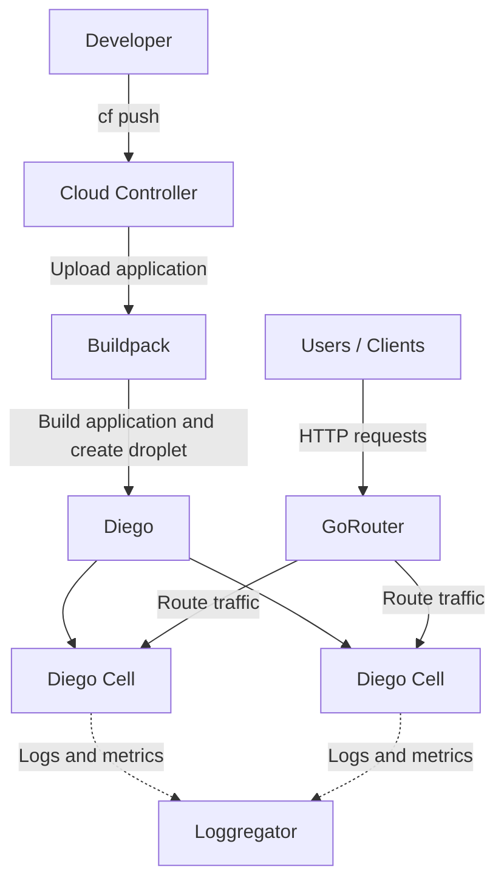
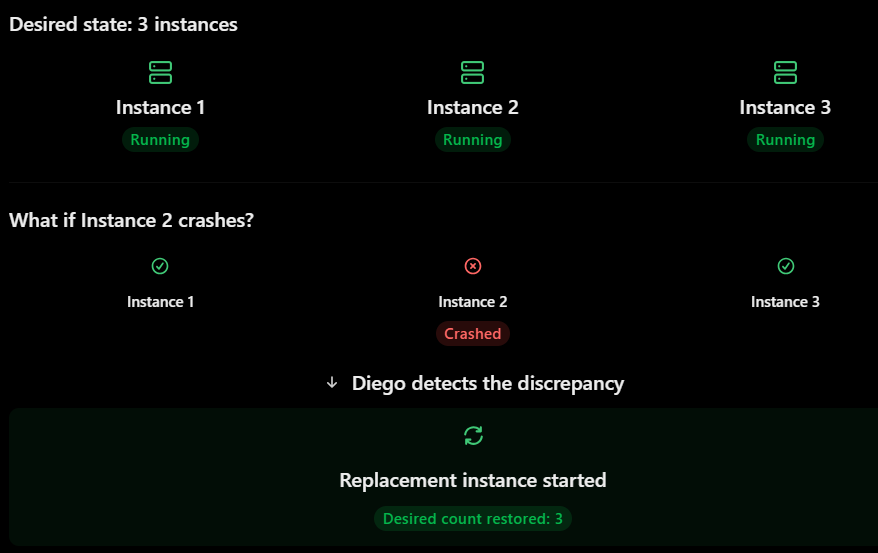
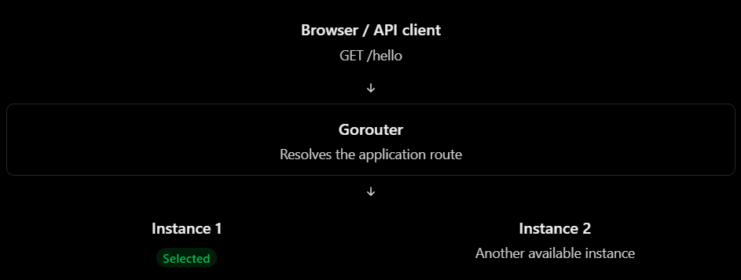
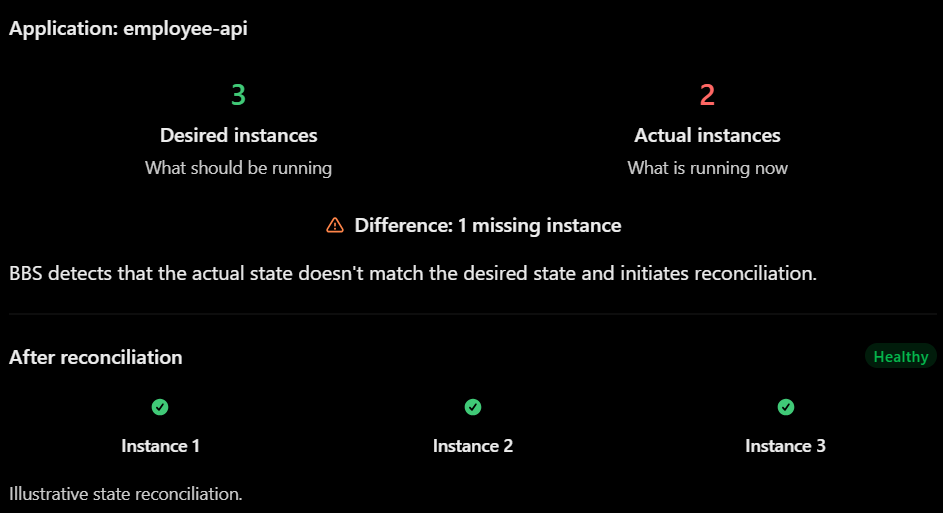
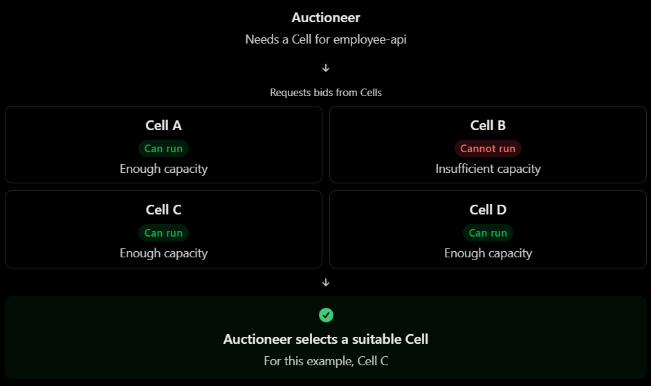
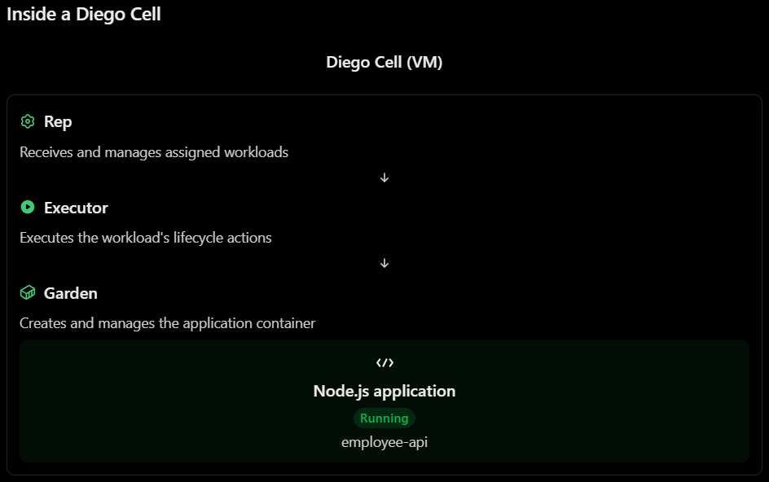
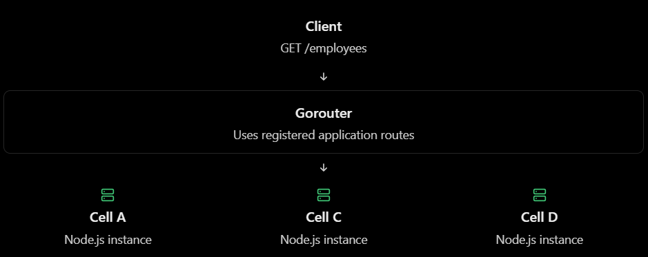
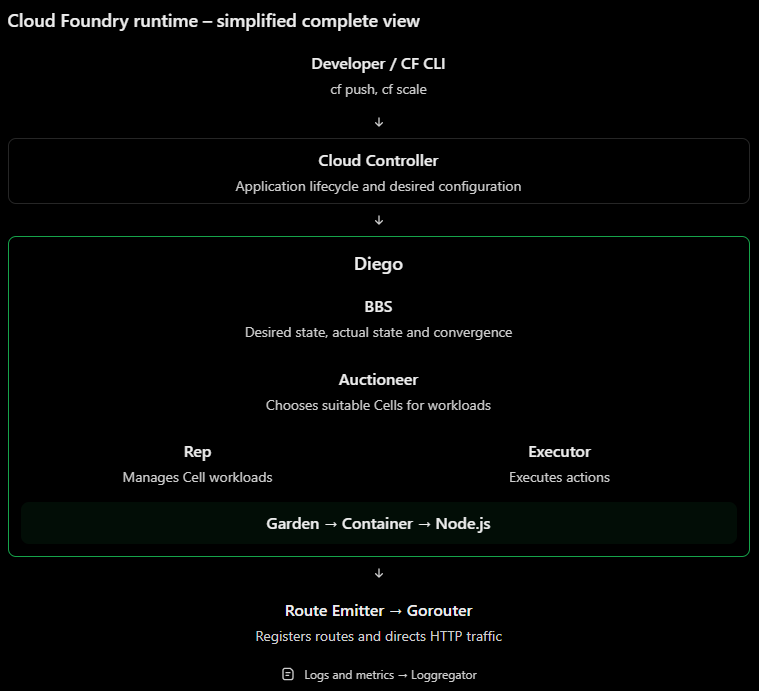
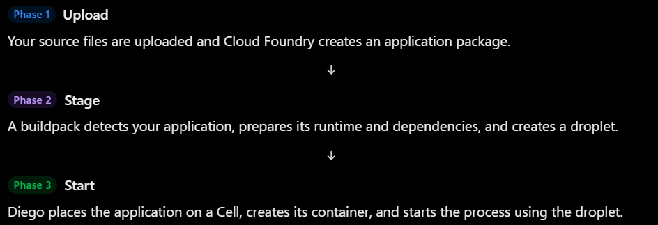
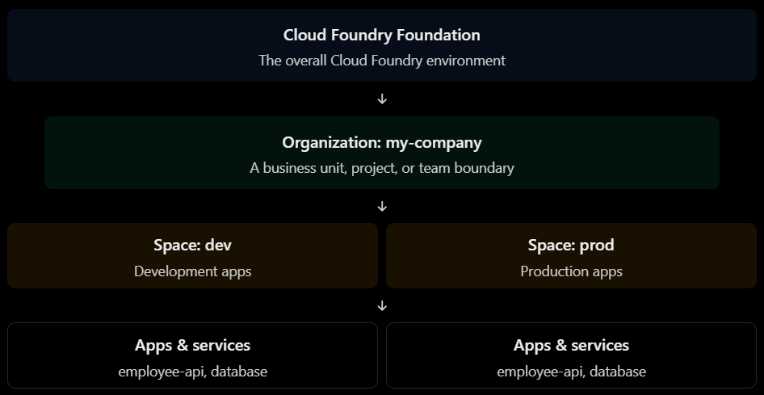

# Cloud Foundry Core Foundations

## Cloud Foundry overview and architecture

Cloud Foundry is an open-source Cloud Application Platform that provides an environment to deploy, run, manage and scale applications without requiring developers to manage the underlying infrastructure directly.

Cloud Foundry consists of several components that cooperate to deploy and run applications.

The following diagram illustrates a simplified view of how an application is deployed and runs on Cloud Foundry.



### How it works

1. **Developer:** Pushes the application to Cloud Foundry using the CF CLI (`cf push`).
2. **Cloud Controller:** Receives the deployment request and coordinates the application deployment.
3. **Buildpack:** Prepares the application runtime, installs dependencies, and creates a droplet.
4. **Diego:** Manages application scheduling and execution.
5. **Diego Cells:** Run the application instances in containers. Multiple instances can run across different cells.
6. **GoRouter:** Receives incoming HTTP requests and routes them to running application instances.
7. **Loggregator:** Collects application logs and metrics for monitoring and troubleshooting.

> **Note:** This is a simplified conceptual diagram, not a complete representation of Cloud Foundry's internal architecture. In SAP BTP, some infrastructure components are managed by SAP and may not be directly visible to application developers.

### 1. Cloud Controller – the manager

Think of Cloud Controller as the central management API of Cloud Foundry.

When you execute:
```
cf push my-node-app
```

The Cloud Controller receives the deployment request.
It is responsible for things like:
- Managing application information.
- Managing orgs and spaces.
- Managing application configurations.
- Managing service instances and bindings.
- Coordinating application deployment and lifecycle operations.

For example, when you execute:

```
cf scale my-node-app -i 3
```

Cloud Controller processes the request to change the desired number of application instances.
> Remember: Cloud Controller manages the application lifecycle, but it doesn't directly run the Node.js process.

Official reading: [Cloud Controller](https://docs.cloudfoundry.org/concepts/architecture/cloud-controller.html).

### 2. Diego – the application runtime manager

Diego is responsible for scheduling and managing application instances.

Imagine you request three instances of the application:

```
cf scale my-node-app -i 3
```

Cloud Foundry needs to:
1. Determine where the application instances should run.
2. Find available resources.
3. Start the application containers.
4. Monitor their status.
5. Restart instances when necessary to maintain the desired state.

Diego handles these responsibilities.

For example:



This is called self-healing behavior.

> Remember: Cloud Controller tells Cloud Foundry what should happen; Diego coordinates the work of running the application instances.

Official reading: [Diego components and architecture](https://docs.cloudfoundry.org/concepts/diego/diego-architecture.html).

### 3. Diego Cells – where the application runs

A Diego Cell is a virtual machine that hosts application containers.

For example:
- Diego Cell A hosts the application instance 1.
- Diego Cell B hosts the application instance 2.
- Diego Cell C hosts the application instance 3.

Inside these containers, the Node.js processes actually execute.

You don't normally need to manage these VMs yourself when using SAP BTP's managed Cloud Foundry environment.

> Remember: Diego is the system responsible for scheduling and managing; Diego Cells provide the execution environment.

### 4. Gorouter – the traffic manager

Imagine the application is accessible through:

```
https://my-node-app.cfapps.eu10.hana.ondemand.com
```

A user sends an HTTP request:

```
GET /hello
```

**How does that request reach the Node.js application?**

Gorouter handles incoming application traffic and routes it to an appropriate running instance.

For example:



Official reading: [Routing Architecture](https://docs.cloudfoundry.org/concepts/cf-routing-architecture.html).

### 5. Buildpacks – preparing the application

The Node.js application needs a suitable runtime environment.

For example, it needs:
- Node.js.
- Required NPM dependencies.
- The correct application start command.
- A suitable execution environment.

Cloud Foundry uses a buildpack to prepare the application. When you deploy a Node.js application, the Node.js buildpack detects the application type and prepares it to run. The result of staging is called a droplet.

The simple relationship:
- Source code = what you upload.
- Buildpack = prepares the application.
- Droplet = the staged application artifact ready to run.

### 6. Loggregator – collecting logs and metrics

When your Node.js application runs, it produces logs:

```
console.log("Application started");
console.error("Database connection failed");
```

**How can you see these logs when the application is running in the cloud?**

Cloud Foundry uses its logging and metrics infrastructure, known as Loggregator, to collect and stream application logs and metrics.

A developer can access application logs using:
```
cf logs my-node-app
```

## Diego architecture and scheduling

For learning purposes, divide Diego into four main areas:
1. Diego Brain – scheduling decisions.
2. BBS – keeping track of desired and actual state.
3. Diego Cells – executing application processes.
4. Auctioneer – deciding which Cell should run a process.

### 1. Diego Brain – the scheduler

Its main responsibility is to coordinate work across the Diego Cells.
It contains components such as:
- Auctioneer – distributes work across Cells.
- BBS – maintains information about application processes and their state.

It coordinates the runtime rather than executing the Node.js application.

### 2. BBS – Bulletin Board System

Imagine Cloud Foundry needs to maintain three instances of your application.

BBS maintains information about:
- How many instances should be running.
- How many instances are actually running.
- Which instances are currently being started or stopped.
- Which tasks need to be executed.

This brings us to two important terms:
- DesiredLRP: The expected state of a long-running process
- ActualLRP: The current state of a long-running process

> LRP stands for Long-Running Process.

For example:



The process of comparing desired and actual state and correcting differences is called convergence. This is a central concept in Cloud Foundry.

For example:
- Desired = 3, Actual = 2 → start another instance.
- Desired = 3, Actual = 4 → stop the extra instance.
- Desired = 3, Actual = 3 → no correction needed.

**One important detail:** BBS doesn't itself execute the Node.js process. It tracks state and coordinates the work required to achieve the desired state.

### 3. Auctioneer – choosing where to run applications
Now imagine you have five Diego Cells:
| Diego Cell | Available memory |
|----------- | ---------------- |
| Cell A | 1 GB |
| Cell B | 2 GB |
| Cell C | 512 MB |
| Cell D | 3 GB |
| Cell E | 1.5 GB |

You want to start a Node.js application that requires 512 MB of allocated memory.

**Which Cell should run it?**

Diego uses an auction mechanism.

The Auctioneer asks the available Cells to indicate whether they can accommodate the workload.

Each Cell's Rep evaluates whether it has enough available resources.

The Auctioneer then selects an appropriate Cell.

The selection considers factors such as:
- Available resources.
- Existing workload.
- Distribution of application instances.
- Availability zones.

This is not necessarily a simple "choose the Cell with the most memory" algorithm.
The goal is to distribute workloads appropriately across the available infrastructure.

Simplified auction example:



The important thing is that the Auctioneer doesn't create the container itself. It coordinates placement.

Official reading: [How Diego balances app processes](https://docs.cloudfoundry.org/concepts/diego/diego-auction.html).

### 4. Diego Cells – executing the application

A Diego Cell is a virtual machine hosting the components responsible for executing application workloads.

The most important internal components to know are:
| Component | Responsibility |
|---------- | -------------- |
| Rep | Represents the Cell in Diego and manages workloads assigned to it |
| Executor | Executes the actions needed to run application processes |
| Garden | Provides and manages containers |
| Metron Agent | Forwards logs and metrics |

Let's see how they work together.
Suppose the Auctioneer selects Cell C.
1. The Rep on Cell C accepts the assigned workload.
2. The Rep coordinates with the Executor.
3. The Executor uses Garden to create a container.
4. The application droplet is made available inside the container.
5. The Node.js start command is executed.
6. The application starts running.



### Important distinction: LRP vs. Task

#### LRP – Long-Running Process
A process that is expected to run continuously.
Examples:
- Node.js REST API.
- Express server.
- Background worker.
- Application server.

The deployed Node.js API is typically an LRP.

#### Task
A process that runs to completion.
Examples:
- Database migration.
- One-time data import.
- Background calculation.
- Scheduled batch operation.

Here's the difference:
| Characteristic | LRP | Task |
| -------------- | --- | ---- |
| Execution | Continuous | Finite |
| Expected to stay running | Yes | No |
| Has desired instance count | Yes | No continuous replica count |
| Example | REST API | Data migration |

A useful real-world example:

Imagine the Node.js application needs to import 100,000 employee records.

There could be:
- An LRP running your REST API.
- A Task executing the one-time import.

Both are workloads that Diego can schedule and execute.

###  What happens when the Node.js application crashes?

There's a deployed Node.js API with three instances.
```
cf scale employee-api -i 3
```

Everything works correctly.

Then, suddenly, one of the Node.js processes crashes.

For example, the application encounters an unhandled exception.

```
throw new Error("Unexpected application failure");
```

What happens next?

#### Application crash and recovery

1. Application crashes → One Node.js process terminates inside its container.
2. Rep detects the change → The Rep on the Diego Cell detects that the container/process is no longer running as expected.
3. BBS receives updated state → The actual state is updated, and the discrepancy with the desired state becomes visible.
4. Convergence detects the difference → Desired instances = 3. Actual instances = 2.
5. Auctioneer coordinates replacement placement → A suitable Diego Cell is selected for the missing instance.
6. New container starts → The new application process is started.
7. Desired state is restored → Your application is back to three running instances.

This is one of the most valuable features of Cloud Foundry.

You specify how many instances you want, and the platform works to maintain that desired state.

However, remember something important:

**Self-healing doesn't mean your application code is fixed.**

If your application has a bug that causes every new instance to crash, Cloud Foundry may keep trying to restore instances, but the underlying bug remains.

That's why application logs and troubleshooting are still important.

### How does Gorouter fit into this architecture?

Diego starts and manages application instances, but users still need to access those instances.

That's where Gorouter comes in.

When an instance starts, the route-emitter component on the Diego Cell communicates routing information to Gorouter.4

For example:
```
https://employee-api.cfapps.eu10.hana.ondemand.com
```

Imagine three instances are running:
- Instance 1 on Cell A.
- Instance 2 on Cell C.
- Instance 3 on Cell D.

Gorouter uses routing information to direct incoming requests to available instances.



Notice the distinction:
- Diego manages where applications run.
- Gorouter manages how HTTP traffic reaches them.

### Conceptual View

The diagram is a conceptual view. Some communication paths are simplified, and the components are distributed across different platform VMs.



Official reading: [Diego components and architecture](https://docs.cloudfoundry.org/concepts/diego/diego-architecture.html).

## Staging and buildpacks

Cloud Foundry doesn't simply copy the source code into a container and run it. It first prepares the application using a buildpack. That preparation process is called staging.

### The three phases of cf push



Diego places the application on a Cell, creates its container, and starts the process using the droplet.
These phases help you identify where a deployment problem occurs: upload, staging, or startup.

Official reading: [Staging your apps in Cloud Foundry](https://docs.cloudfoundry.org/concepts/how-applications-are-staged.html).

### What is a buildpack?

A buildpack is a set of scripts and dependencies that prepares your application to run on Cloud Foundry.

For a Node.js application, the Node.js buildpack typically:
- Detects that the project is a Node.js application.
- Selects a compatible Node.js runtime.
- Installs or prepares application dependencies.
- Determines how the application should start.
- Produces the staged application artifact.

Cloud Foundry's Node.js buildpack normally detects a Node.js project when it finds a package.json in the project root.

The `engines.node` field expresses the Node.js version your application requires. Make sure the selected version is supported by the buildpack installed in your target Cloud Foundry environment.

Official reading: [Node.js buildpack](https://docs.cloudfoundry.org/buildpacks/node/).

### What is a droplet?

A droplet is the packaged, executable result of staging.

Think of the distinction this way:
| Item | Meaning | Source code |
| ---- | ------- | ----------- |
| Your original project files | Buildpack | Prepares the project to run |
| Staging | The preparation process | Droplet |
| The resulting runnable artifact | Container | The environment where the droplet runs |

The droplet contains your application and the runtime/dependencies prepared during staging. Diego can then use that droplet to start application instances on Cells.

### How does Cloud Foundry know how to start Node.js?

The package.json defines a start script:

```json
{
  "scripts": {
    "start": "node server.js"
  }
}
```

The Node.js buildpack can use this to determine the default web process command.

There is one important Cloud Foundry requirement: your web server must listen on the port provided through the PORT environment variable.

For example, with Express:

```js
const express = require("express");

const app = express();

const port = process.env.PORT || 3000;

app.get("/", (req, res) => {
  res.send("Hello from Cloud Foundry!");
});

app.listen(port, () => {
  console.log(`Server listening on ${port}`);
});
```

Why `process.env.PORT`?

Cloud Foundry controls the port allocated to your application. Hardcoding a port such as 3000 can prevent the platform's routing from reaching the app correctly.

### Staging vs. running: an important distinction

These are separate operations:
- Staging: prepares a new droplet from your source code and buildpack.
- Running: starts an application process using an existing droplet.

This distinction explains two useful commands:

```
cf restart employee-api
```

Restarts the application using its existing droplet.

```
cf restage employee-api
```

Runs staging again to create a new droplet, then starts the application.

For example, if you change an environment variable that the buildpack uses during staging, you may need cf restage, not just cf restart.

Official reading: [Starting, restarting, and restaging your apps](https://docs.cloudfoundry.org/devguide/deploy-apps/start-restart-restage.html).

## Orgs, spaces, roles and permissions

### The hierarchy

A Cloud Foundry installation is called a foundation. Inside it, resources are organized into organizations (orgs) and spaces.



- Foundation: the overall platform installation.
- Org: groups users, spaces, quotas, service availability and custom domains.
- Space: a working area for deploying and managing applications, services and routes.

An org can contain multiple spaces. Apps, services and routes belong to a specific space.

Official reading: [Orgs, spaces, roles, and permissions in Cloud Foundry](https://docs.cloudfoundry.org/concepts/roles.html), [Planning orgs and spaces in Cloud Foundry](https://docs.cloudfoundry.org/concepts/orgs-and-spaces.html).

### Roles and permissions
Cloud Foundry uses role-based access control (RBAC). A role determines what a user can do and at which level.
The roles you'll most often encounter are:

| Role | Main responsibility |
| ---- | ------------------- |
| Org Manager | Administers an org and manages its spaces and org-level roles |
| Org Auditor | Read-only org-level visibility |
| Space Manager | Manages a space and its roles |
| Space Developer | Deploys and manages apps and services |
| Space Auditor | Read-only access to a space |
| Space Supporter | Troubleshoots apps and service bindings |

There are also platform-level roles, such as Admin and Global Auditor.
A subtle but important detail: Org Manager does not automatically mean Space Developer. Org-level and space-level permissions are separate. A person needs the appropriate space role to deploy applications there.

Official reading: [User role permissions](https://docs.cloudfoundry.org/concepts/roles.html#permissions).

### Working with orgs and spaces using the CLI

These are commands worth knowing:

```
# Log in
cf login

# List available orgs
cf orgs

# List spaces in an org
cf spaces

# Show current target
cf target

# Target a specific org and space
cf target -o acme-company -s development

# List applications in the current space
cf apps
```
To inspect users and roles:
```
cf org-users acme-company

cf space-users acme-company development
```

To assign a Space Developer role (assuming you have sufficient privileges):
```
cf set-space-role \
  developer@example.com \
  acme-company \
  development \
  SpaceDeveloper
```
The user must first have an org role in the parent org before receiving a space role.

Official reading: [Managing roles in Cloud Foundry](https://docs.cloudfoundry.org/concepts/managing-roles.html).

## Networking and HTTP routing


