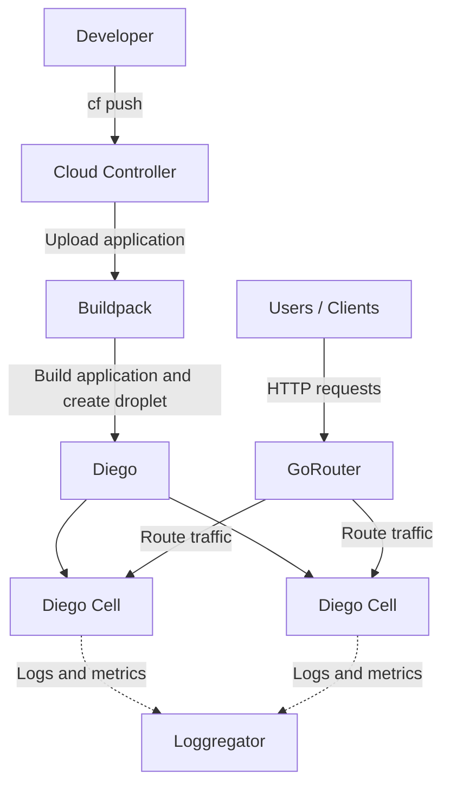

# Cloud Foundry Core Foundations

## Cloud Foundry overview and architecture

Cloud Foundry is an open-source Cloud Application Platform that provides an environment to deploy, run, manage and scale applications without requiring developers to manage the underlying infrastructure directly.

Cloud Foundry consists of several components that cooperate to deploy and run applications.

The following diagram illustrates a simplified view of how an application is deployed and runs on Cloud Foundry.



### How it works

1. **Developer:** Pushes the application to Cloud Foundry using the CF CLI (`cf push`).
2. **Cloud Controller:** Receives the deployment request and coordinates the application deployment.
3. **Buildpack:** Prepares the application runtime, installs dependencies, and creates a droplet.
4. **Diego:** Manages application scheduling and execution.
5. **Diego Cells:** Run the application instances in containers. Multiple instances can run across different cells.
6. **GoRouter:** Receives incoming HTTP requests and routes them to running application instances.
7. **Loggregator:** Collects application logs and metrics for monitoring and troubleshooting.

> **Note:** This is a simplified conceptual diagram, not a complete representation of Cloud Foundry's internal architecture. In SAP BTP, some infrastructure components are managed by SAP and may not be directly visible to application developers.


### Main Components
#### 1. Cloud Controller – the manager

Think of Cloud Controller as the central management API of Cloud Foundry.

When you execute:
```
cf push my-node-app
```

The Cloud Controller receives the deployment request.
It is responsible for things like:
- Managing application information.
- Managing orgs and spaces.
- Managing application configurations.
- Managing service instances and bindings.
- Coordinating application deployment and lifecycle operations.

For example, when you execute:

```
cf scale my-node-app -i 3
```

Cloud Controller processes the request to change the desired number of application instances.
> Remember: Cloud Controller manages the application lifecycle, but it doesn't directly run the Node.js process.

Official reading: [Cloud Controller](https://docs.cloudfoundry.org/concepts/architecture/cloud-controller.html).

#### 2. Diego – the application runtime manager

Diego is responsible for scheduling and managing application instances.

Imagine you request three instances of the application:

```
cf scale my-node-app -i 3
```

Cloud Foundry needs to:
1. Determine where the application instances should run.
2. Find available resources.
3. Start the application containers.
4. Monitor their status.
5. Restart instances when necessary to maintain the desired state.

Diego handles these responsibilities.

For example:


This is called self-healing behavior.

> Remember: Cloud Controller tells Cloud Foundry what should happen; Diego coordinates the work of running the application instances.

Official reading: [Diego components and architecture](https://docs.cloudfoundry.org/concepts/diego/diego-architecture.html).

#### 3. Diego Cells – where the application runs

A Diego Cell is a virtual machine that hosts application containers.

For example:
- Diego Cell A hosts the application instance 1.
- Diego Cell B hosts the application instance 2.
- Diego Cell C hosts the application instance 3.

Inside these containers, the Node.js processes actually execute.

You don't normally need to manage these VMs yourself when using SAP BTP's managed Cloud Foundry environment.

> Remember: Diego is the system responsible for scheduling and managing; Diego Cells provide the execution environment.

#### 4. Gorouter – the traffic manager

Imagine the application is accessible through:

```
https://my-node-app.cfapps.eu10.hana.ondemand.com
```

A user sends an HTTP request:

```
GET /hello
```

**How does that request reach the Node.js application?**

Gorouter handles incoming application traffic and routes it to an appropriate running instance.

For example:


Official reading: [Routing Architecture](https://docs.cloudfoundry.org/concepts/cf-routing-architecture.html).

#### 5. Buildpacks – preparing the application

The Node.js application needs a suitable runtime environment.

For example, it needs:
- Node.js.
- Required NPM dependencies.
- The correct application start command.
- A suitable execution environment.

Cloud Foundry uses a buildpack to prepare the application. When you deploy a Node.js application, the Node.js buildpack detects the application type and prepares it to run. The result of staging is called a droplet.

The simple relationship:
- Source code = what you upload.
- Buildpack = prepares the application.
- Droplet = the staged application artifact ready to run.

#### 6. Loggregator – collecting logs and metrics

When your Node.js application runs, it produces logs:

```
console.log("Application started");
console.error("Database connection failed");
```

**How can you see these logs when the application is running in the cloud?**

Cloud Foundry uses its logging and metrics infrastructure, known as Loggregator, to collect and stream application logs and metrics.

A developer can access application logs using:
```
cf logs my-node-app
```

## Runtime components

## Diego architecture and scheduling

## Staging and buildpacks

## Orgs, spaces, roles and permissions

## Networking and HTTP routing


