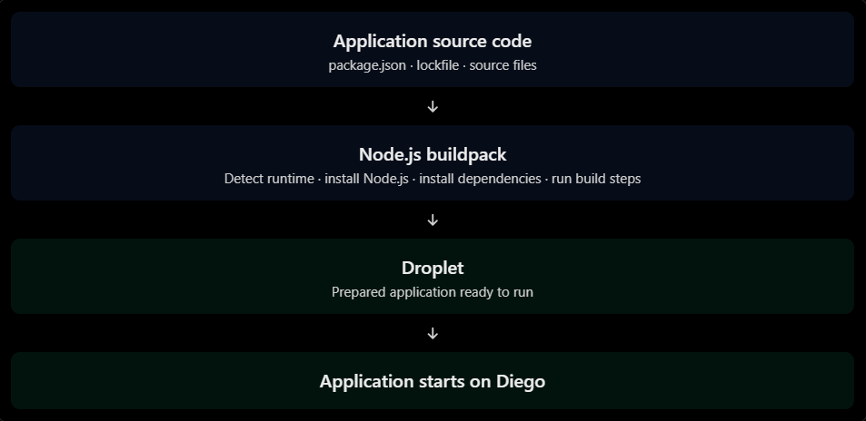
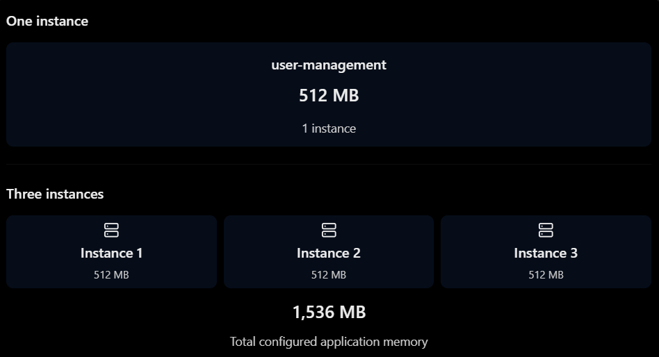

# Deploy and Manage Node.js Applications

## `cf push`

cf push is the command used to deploy an application to Cloud Foundry.

It tells Cloud Foundry:
> Take my application, prepare it for execution, create the required runtime resources, and start it.

For the [nestjs-cf](../nestjs-cf/) application:
```
cf push
```

Cloud Foundry reads `manifest.yml` from the current directory by default.

You can also specify the application name:
```
cf push user-management
```

Or specify a different manifest:
```
cf push -f manifest-dev.yml
```

#### What happens internally?

The deployment process can be understood as two major phases:

**Phase 1 — Build and staging**
1. Upload application package
Cloud Foundry receives your application files.
2. Detect buildpack
The Node.js buildpack detects that this is a Node.js application.
3. Install runtime and dependencies
It installs the required Node.js version and application dependencies.
4. Build the droplet
The buildpack prepares the executable application environment.

**Phase 2 — Application execution**
1. Create container
Diego schedules an application instance on a Diego Cell.
2. Download droplet
The Cell receives the prepared application environment.
3. Execute start command
Your application starts using npm run start:prod.
4. Health monitoring
Cloud Foundry monitors the application instance.
5. Route traffic
Gorouter directs incoming requests to healthy application instances.

A useful distinction:
- **Staging** prepares the application.
- **Running** executes the application.

A successful staging operation does not automatically mean the application is running successfully. Both phases must complete.

### What happened during nestjs-cf deployment?   

The successful deployment log confirms this sequence:   

|                      Log evidence   <br> |                                Meaning   <br> |
|:-----------------------------------------|:----------------------------------------------|
| `Downloaded app package (167.7K)`   <br> |    Application source package uploaded   <br> |
|  `Nodejs Buildpack version 1.9.6`   <br> |             Node.js buildpack selected   <br> |
|         `Installing node 22.23.4`   <br> |              Node.js runtime installed   <br> |
|         `Installing pnpm 12.15.0`   <br> |        pnpm installed by the buildpack   <br> |
|                  `Packages: +709`   <br> |                 Dependencies installed   <br> |
|                `Staging complete`   <br> |           Droplet successfully created   <br> |
|     `Downloaded droplet (119.7M)`   <br> | Runtime environment downloaded to Cell   <br> |
|          `Invoking start command`   <br> |          Application startup initiated   <br> |
|                  `node dist/main`   <br> |    NestJS application process launched   <br> |

**Important**: Specify the Node.js version in the package.json or .nvmrc so that the local development and Cloud Foundry runtime use compatible versions.

For example, in package.json:
```json
{
  "engines": {
    "node": "22.x"
  }
}
```

The exact version should be chosen according to the project's compatibility requirements and the versions supported by the buildpack.

## Application manifests

### What is a manifest?

An application manifest is a YAML file that describes how Cloud Foundry should deploy and configure your application.

The default filename is:
```
manifest.yml
```

Instead of specifying every deployment option manually through CLI arguments, you declare them in one file.
Think of it as a deployment configuration document.

### The sample manifest

Here's the simplified configuration:

```yaml
---
applications:
  - name: user-management
    command: npm run start:prod
    buildpacks:
      - nodejs_buildpack
```

Let's understand each property.   
|       Property   <br> |                                         Meaning   <br> |
|:----------------------|:-------------------------------------------------------|
| `applications`   <br> |                  List of applications to deploy   <br> |
|         `name`   <br> |               Application name in Cloud Foundry   <br> |
|      `command`   <br> |           Command used to start the application   <br> |
|   `buildpacks`   <br> |      Buildpacks used to prepare the application   <br> |

#### Application name
```
name: user-management
```

This is the name Cloud Foundry uses to identify your application.

You can inspect it using:
```
cf apps
```

#### Start command
```
command: npm run start:prod
```

This corresponds to the [package.json](../nestjs-cf/package.json) script:
```
"start:prod": "node dist/main"
```

So the actual command executed is:
```
node dist/main
```

Remember that the NestJS application must listen on the port assigned by Cloud Foundry:
```
await app.listen(process.env.PORT ?? 3000);
```
Cloud Foundry provides the port through the PORT environment variable.

#### Buildpacks

```yaml
buildpacks:
  - nodejs_buildpack
```

A buildpack prepares the application to run in Cloud Foundry.

For Node.js, it handles things such as:
- Selecting the Node.js runtime.
- Installing dependencies.
- Preparing the application runtime.
- Producing the droplet.

The buildpack does not replace the application build process. It provides the environment in which the application is prepared and executed.

Official reading: [App manifest attribute reference](https://docs.cloudfoundry.org/devguide/deploy-apps/manifest-attributes.html)

### Manifest versus CLI arguments

You can configure deployment through CLI arguments:
```
cf push user-management \
  -i 2 \
  -m 512M
```

Or through a manifest:
```yaml
applications:
  - name: user-management
    instances: 2
    memory: 512M
```

The manifest is generally preferable for repeatable deployments because the configuration is version-controlled alongside your application.

You can also use:
```
cf push -f manifest.yml
```

## Environment variables

There are four useful categories to understand:
1. Application-defined variables.
2. Running environment variable group.
3. Staging environment variable group.
4. System-provided variables.

### 1. Application-defined variables

These are variables you define for the application.

For example, in `manifest.yml`:
```yaml
applications:
  - name: user-management
    env:
      NODE_ENV: production
      LOG_LEVEL: info
```

Or through the CLI:
```
cf set-env user-management LOG_LEVEL debug
```

Read them in NestJS/Node.js:
```
const logLevel = process.env.LOG_LEVEL;
const nodeEnv = process.env.NODE_ENV;
```

These are application-specific configuration values.

### 2. Running Environment Variable Group (App-Independent)

The deployment shows:
```
LOG4J_FORMAT_MSG_NO_LOOKUPS: true
```

This is a platform-level environment variable group applied to running application processes.

The important distinction:
- It is not defined in your manifest.yml.
- It is not specific to the application.
- It is supplied by the Cloud Foundry platform configuration.

Your Node.js process can still access it:
```
console.log(process.env.LOG4J_FORMAT_MSG_NO_LOOKUPS);
```

Although this particular variable is associated with Java logging, it can appear in the environment of a Node.js application too.

### 3. Staging Environment Variable Group (App-Independent)

These variables are available during the staging phase, when Cloud Foundry prepares your application.

For example:
- GIT_HTTP_USER_AGENT identifies the Git HTTP client user agent in relevant Git operations.
- LOG4J_FORMAT_MSG_NO_LOOKUPS is also present in the staging environment.

The difference between running and staging is important:   
|                       Running environment   <br> |                          Staging environment   <br> |
|:-------------------------------------------------|:----------------------------------------------------|
|       Used when application processes run   <br> |       Used while application is being staged   <br> |
| Available to your running Node.js process   <br> | Available to buildpack and staging processes   <br> |
|                     Runtime configuration   <br> |             Build-time/staging configuration   <br> |

You generally don't need to define these variables yourself.

### 4. System-Provided Variables

Cloud Foundry automatically provides metadata about your application and its environment.

Two important variables are:
- VCAP_APPLICATION
- VCAP_SERVICES

They contain JSON-formatted information.

#### 4.1 VCAP_APPLICATION

The deployment includes:

```json
{
  "VCAP_APPLICATION": {
    "cf_api": "https://api.cf.us10-001.hana.ondemand.com",
    "limits": {
      "fds": 32768
    },
    "application_name": "user-management",
    "application_uris": [
      "user-management.cfapps.us10-001.hana.ondemand.com"
    ],
    "name": "user-management",
    "space_name": "dev",
    "space_id": "...",
    "organization_id": "...",
    "organization_name": "...",
    "application_id": "..."
  }
}
```

This provides metadata about the currently running application.   
Let's look at the most useful properties:   
|            Property   <br> |                          Meaning   <br> |
|:---------------------------|:----------------------------------------|
|  `application_name`   <br> |                 Application name   <br> |
|    `application_id`   <br> |    Unique application identifier   <br> |
|  `application_uris`   <br> |               Application routes   <br> |
|        `space_name`   <br> | Space containing the application   <br> |
|          `space_id`   <br> |          Unique space identifier   <br> |
| `organization_name`   <br> |                Organization name   <br> |
|   `organization_id`   <br> |   Unique organization identifier   <br> |
|            `cf_api`   <br> |       Cloud Foundry API endpoint   <br> |
|        `limits.fds`   <br> |            File descriptor limit   <br> |
|              `name`   <br> |                 Application name   <br> |

For example, your application can read its own route:
```
const appInfo = JSON.parse(
  process.env.VCAP_APPLICATION ?? '{}',
);

console.log(appInfo.application_name);
console.log(appInfo.application_uris);
console.log(appInfo.space_name);
```

This can be useful when building diagnostics endpoints or application startup logging.
You don't need to hardcode the application name, space, or route in your source code.

#### 4.2 VCAP_SERVICES

VCAP_SERVICES contains information about services bound to your application.

You normally should not manually create or edit VCAP_APPLICATION or VCAP_SERVICES. Cloud Foundry manages these variables.

### How do we inspect these variables?   

These are useful commands to remember:   
|                                Command   <br> |                                        Purpose   <br> |
|:----------------------------------------------|:------------------------------------------------------|
|               `cf env user-management`   <br> |      Inspect application environment variables   <br> |
|                       `cf running-env`   <br> | Inspect the running environment variable group   <br> |
|                       `cf staging-env`   <br> | Inspect the staging environment variable group   <br> |
| `cf set-env user-management KEY value`   <br> |                    Set an application variable   <br> |
|     `cf unset-env user-management KEY`   <br> |                 Remove an application variable   <br> |

After changing an application environment variable, you generally need to restart or restage the application for the change to take effect, depending on the change.   

## Node.js buildpack

The Node.js buildpack prepares the Node.js application to run in Cloud Foundry. It detects the application type, installs the required runtime and dependencies, and creates a deployable droplet.

### What happens during staging?



### Important configuration

| Configuration                    | Purpose                                                 |
| -------------------------------- | ------------------------------------------------------- |
| `buildpacks: [nodejs_buildpack]` | Selects the Node.js buildpack                           |
| `engines.node` in `package.json` | Specifies the desired Node.js version                   |
| lock files                       | Provides dependency version information                 |
| `command` in manifest            | Specifies how the application starts                    |

### What happened in nestjs-cf deployment?

Your successful staging log showed:

- Node.js buildpack version `1.9.6`.
- Stack `cflinuxfs5`.
- Node.js `22.23.4` selected because you hadn't specified a Node.js version.
- pnpm `12.15.0` installed by the buildpack.
- Staging completed and a droplet of approximately 119.7 MB was created.

Key takeaway: The buildpack prepares your application; it does not run your application continuously. That happens after staging, when Cloud Foundry starts the application instance.

## Memory and instance scaling

Cloud Foundry lets you control two important deployment dimensions:

1. Memory: How much memory each application instance can use.
2. Instances: How many copies of your application run.

### Memory per instance

The [manifest](../nestjs-cf/manifest.yml) currently specifies:

```yaml
applications:
  - name: user-management
    memory: 512M
    instances: 1
```

This means each instance receives a memory limit of 512 MB.

If the application exceeds its available memory, it can be terminated due to memory pressure.

### 2. Instance scaling

Suppose you increase the instance count:

```yaml
applications:
  - name: user-management
    memory: 512M
    instances: 3
```

Cloud Foundry runs three instances of your NestJS application.



This is the memory quota consumed by those three instances, subject to Cloud Foundry's accounting and quota rules.

### 3. Vertical vs. horizontal scaling

| Type               | What changes?       | Example       |
| ------------------ | ------------------- | ------------- |
| Vertical scaling   | Memory per instance | 512 MB → 1 GB |
| Horizontal scaling | Number of instances | 1 → 3         |

Useful commands:

```
# Inspect current application configuration
cf app user-management

# Scale to 3 instances
cf scale user-management -i 3

# Increase memory per instance
cf scale user-management -m 1G

# Change both
cf scale user-management -i 3 -m 1G
```

### 4. Why multiple instances matter

Cloud Foundry's Gorouter distributes incoming requests across available application instances.

For example:

```
                Client requests
                       |
                    Gorouter
                  /    |    \
                 /     |     \
           Instance 1  2     3
```

This improves the application's ability to handle concurrent traffic and provides resilience if an individual instance fails.

## Logs and troubleshooting

Cloud Foundry provides several ways to inspect application logs, events, and runtime status.

### 1. Application logs

Logs help you understand what happens during application execution.

For example, the `nestjs-cf` application might produce:

```
[Nest] 1  - LOG [NestFactory] Starting Nest application...
[Nest] 1  - LOG [InstanceLoader] AppModule dependencies initialized
[Nest] 1  - LOG [RoutesResolver] UserController {/users}
[Nest] 1  - LOG [NestApplication] Nest application successfully started
```

Cloud Foundry collects application logs and makes them available through the CLI.

Important commands:

| Command                            | Purpose                             |
| ---------------------------------- | ----------------------------------- |
| `cf logs user-management`          | Stream application logs             |
| `cf logs user-management --recent` | Display recent logs                 |
| `cf app user-management`           | Inspect application status          |
| `cf events user-management`        | Show application lifecycle events   |
| `cf crashlogs user-management`     | Inspect logs from crashed instances |

### 2. Understanding log types

Cloud Foundry logs can contain different types of messages.

| Log type | Meaning                    |
| -------- | -------------------------- |
| `OUT`    | Standard output (`stdout`) |
| `ERR`    | Standard error (`stderr`)  |
| `RTR`    | Router-related logs        |
| `STG`    | Staging-related logs       |

For example:

- NestJS `console.log()` messages generally appear as `OUT`.
- NestJS `console.error()` messages generally appear as `ERR`.
- Requests routed through Gorouter can produce `RTR` entries.
- Buildpack and staging messages can appear as `STG`.

### 3. Application logs vs. staging logs

This distinction is particularly important.

Staging phase (STG):
- Buildpack detection
- Node.js installation
- Dependency installation
- Application build and droplet creation

Runtime phase (OUT / ERR):
- NestJS startup
- API requests
- Application errors
- Runtime exceptions

Routing phase (RTR):
- Incoming HTTP requests
- Response status codes
- Request routing information

For example, if your deployment fails because a dependency cannot be installed, investigate staging logs.

If your application starts successfully but the endpoint returns HTTP 500, investigate runtime logs.

### A practical troubleshooting workflow

When your application behaves unexpectedly, follow this order:

1. Check application status
   ```
   cf app user-management
   ```
   Check whether the application is running and how many instances are healthy.
2. Check recent logs
   ```
   cf logs user-management --recent
   ```
   Look for startup errors, exceptions, and crash messages.
3. Inspect application events
   ```
   cf events user-management
   ```
   Look for crashes, restarts, and other lifecycle events.
4. Stream live logs
   ```
   cf logs user-management
   ```
   Keep this running while reproducing the problem.
5. Apply the appropriate fix and redeploy or restart
   ```
   cf restart user-management
   ```
   Use `cf restage user-management` instead if you changed something that requires the buildpack to run again.

## Health checks

A successful application start does not necessarily mean the application is ready to serve traffic. For example, NestJS might start listening on a port but still be unable to perform an essential initialization task.

Cloud Foundry uses health checks to monitor application instances and decide when they are ready.

### Health-check types

Cloud Foundry supports three main health-check types.

| Type      | How it works                                                           |
| --------- | ---------------------------------------------------------------------- |
| `port`    | Checks whether the application is listening on its assigned port       |
| `http`    | Sends an HTTP request to a configured endpoint and checks the response |
| `process` | Checks whether the application process is running                      |

#### Port health check

This is the default health-check type in Cloud Foundry.

For the NestJS application, Cloud Foundry checks whether the application is listening on the assigned port.

The existing code already supports this:

```
await app.listen(process.env.PORT ?? 3000);
```

Cloud Foundry provides the `PORT` environment variable, and your application must listen on that port.

#### HTTP health check

An HTTP health check sends a request to a specific endpoint, such as:

```
GET /health
```

Cloud Foundry expects a successful HTTP response (normally HTTP 2xx).

This is useful when you want to verify that your application is actually responding to HTTP requests, rather than merely listening on a port.

##### Process health check

This checks whether the application process is running.

It does not verify that the application can respond to HTTP requests.

### Configure health checks in the manifest

You can configure the health-check type in `manifest.yml`.

For example, your current application could use:

```
applications:
  - name: user-management
    memory: 512M
    instances: 1
    buildpacks:
      - nodejs_buildpack
    command: npm run start:prod
    health-check-type: port
```

To use an HTTP health check instead:

```
applications:
  - name: user-management
    memory: 512M
    instances: 1
    buildpacks:
      - nodejs_buildpack
    command: npm run start:prod
    health-check-type: http
    health-check-http-endpoint: /health
```

The second configuration assumes that your NestJS application implements `/health`.

### Health-check timeout

Sometimes an application needs additional time to start.

For example, NestJS might need time to initialize modules or perform startup operations.

You can configure a health-check timeout:

```
health-check-type: http
health-check-http-endpoint: /health
health-check-invocation-timeout: 10
```

This sets the timeout for an individual health-check invocation to 10 seconds. It is not the same as allowing the application 10 seconds for its entire startup.

### Configure health checks using CLI

You can also configure health checks without editing the manifest.

```
# Set port health check
cf set-health-check user-management port

# Set HTTP health check
cf set-health-check user-management http --endpoint /health

# Set process health check
cf set-health-check user-management process

# Inspect application configuration
cf app user-management
```

### Important distinction: Health checks and application recovery

Consider this scenario:

1. You deploy three instances of your NestJS application.
2. One instance crashes.
3. Cloud Foundry detects that the instance is unhealthy.
4. Cloud Foundry attempts to restore the desired number of running instances.

This is part of Cloud Foundry's application recovery and convergence behavior.

Health checks help Cloud Foundry determine whether instances are ready or healthy; Diego manages the actual application instances and their lifecycle.

## Blue-green deployments