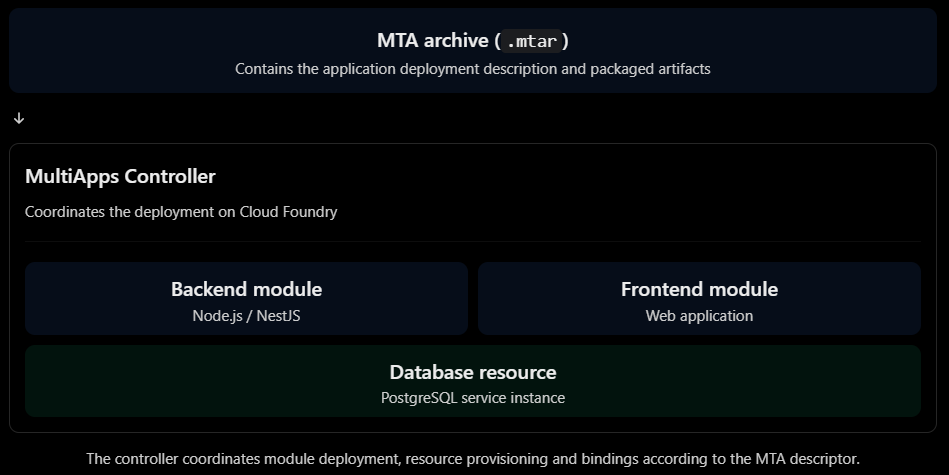
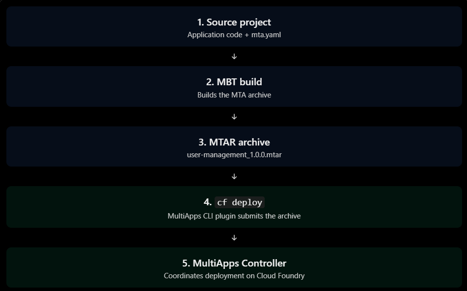

# MTA Deployment

## MTA concepts and architecture

MTA stands for Multi-Target Application.

An MTA is a way to package and deploy an application that consists of multiple related components, potentially running on different runtimes or using different platform services.

For example, a business application might contain:

- A Node.js backend.
- A frontend application.
- An application router.
- A PostgreSQL database service.
- An XSUAA service instance.

Instead of deploying and configuring every component independently, you describe the application and its relationships in an MTA descriptor.

The deployment process then coordinates the components.

### Why do we need MTA?

With a simple `cf push`, you deploy an individual application:

```
cf push user-management
```

But imagine your application grows:

```
user-management/
├── backend/
├── frontend/
├── approuter/
```

Now you may need to:
- Deploy multiple applications.
- Create or reuse service instances.
- Bind services to the correct applications.
- Configure dependencies between modules.
- Update the application as one coordinated deployment.

Managing all these operations manually becomes inconvenient.

MTA provides a declarative way to describe this application landscape.

### MTA architecture

An MTA has two main building blocks:

| Building block | Meaning                                            | Example                                                  |
| -------------- | -------------------------------------------------- | -------------------------------------------------------- |
| Modules        | Deployable application components                  | Node.js backend, App Router, frontend                    |
| Resources      | External services or resources required by modules | PostgreSQL instance, XSUAA instance, destination service |

The modules and resources are described in `mta.yaml`.

Here's a simplified example of an MTA architecture:



### How does MTA deployment work?

There are three important components involved:

| Component            | Responsibility                                                     |
| -------------------- | ------------------------------------------------------------------ |
| MBT                  | Builds the MTA archive from your project and descriptor.           |
| MTAR                 | The packaged deployment artifact.                                  |
| MultiApps Controller | Processes the archive and coordinates deployment on Cloud Foundry. |

The workflow looks like this:



An important distinction: MTA is not another application runtime. The application still runs on the Cloud Foundry runtime. MTA is the packaging and deployment model used to coordinate the application and its dependencies.

## `mta.yaml`

`mta.yaml` is the MTA deployment descriptor.

It describes:

- The application name and version.
- The deployable modules.
- The resources required by those modules.
- Dependencies between modules and resources.
- Build and deployment configuration.

It is written in YAML.

A simplified example:

```yaml
_schema-version: "3.3"
ID: user-management
version: 1.0.0

modules:
  - name: user-management
    type: nodejs
    path: .

resources:
  - name: postgres-db
    type: org.cloudfoundry.managed-service
```

This tells the MTA build and deployment tooling that there is a Node.js module and a managed service resource.

### Understanding the top-level properties

Let's go through the descriptor.

#### `_schema-version`

```yaml
_schema-version: "3.3"
```

Identifies the MTA descriptor schema version.

It tells the MTA tooling which descriptor format you're using. It is not your application version or Node.js version.

#### `ID`

```yaml
ID: user-management
```

The unique identifier of the MTA application.

Think of it as the identity of the overall MTA project.

#### `version`

```yaml
version: 1.0.0
```

The MTA application version.

This is independent of the application's `package.json` version, although you can keep them aligned if that makes versioning easier.

### The `modules` section

A module represents a deployable component of your MTA.

For example:

```yaml
modules:
  - name: user-management
    type: nodejs
    path: .
```

| Property | Meaning                      |
| -------- | ---------------------------- |
| `name`   | Module name                  |
| `type`   | Module type                  |
| `path`   | Location of its source files |

The NestJS backend is a Node.js module.

Other possible modules include HTML5 applications, Java applications, and application routers.

An MTA can contain multiple modules.

### The `resources` section

A resource represents something the application needs but that isn't itself a deployable application module.

For example, the PostgreSQL service.

## Build and deployment parameters

You can also configure how your module is built and deployed.

For example:

```yaml
modules:
  - name: user-management
    type: nodejs
    path: .
    parameters:
      memory: 512M
      disk-quota: 1G
      instances: 1
      buildpack: nodejs_buildpack
      command: npm run start:prod
```

These should look familiar because they correspond to settings you've already used in `manifest.yml`.

| `manifest.yml` | `mta.yaml`                     |
| -------------- | ------------------------------ |
| `name`         | Module `name`                  |
| `memory`       | Module `parameters.memory`     |
| `disk_quota`   | Module `parameters.disk-quota` |
| `instances`    | Module `parameters.instances`  |
| `buildpacks`   | Module `parameters.buildpack`  |
| `command`      | Module `parameters.command`    |
| `services`     | Module `requires`              |

The formats aren't identical, but the concepts are familiar.

## MTA modules and resources

### Modules: deployable application components

A module represents a component that the MTA deployment process can deploy.

Each module has a type that determines how it is handled.

Some common module types include:

| Module type        | Purpose                     | Example              |
| ------------------ | --------------------------- | -------------------- |
| `nodejs`           | Node.js application         | NestJS backend       |
| `java`             | Java application            | Spring Boot backend  |
| `html5`            | HTML5 application content   | SAPUI5 frontend      |
| `approuter.nodejs` | Application Router          | SAP App Router       |
| `hdb`              | SAP HANA database artifacts | HANA database module |

These are examples of module types used in SAP BTP MTA projects. Not every project needs all of them.

#### Example: multiple modules

Imagine your application grows and you introduce a separate frontend and backend.

Your project might look like this:

```
user-management/
├── backend/
│   ├── src/
│   └── package.json
├── frontend/
│   └── ...
├── approuter/
│   ├── xs-app.json
│   └── package.json
└── mta.yaml
```

You could describe the deployable components like this:

```yaml
modules:
  - name: user-management-backend
    type: nodejs
    path: backend

  - name: user-management-frontend
    type: html5
    path: frontend

  - name: user-management-approuter
    type: approuter.nodejs
    path: approuter
```

Each module can have its own build and deployment configuration.

**Important**: A module isn't necessarily a separate business application. Several modules can work together to form one application.

### Resources: external dependencies

Resources describe services or infrastructure that modules need.

For example:

- PostgreSQL database.
- XSUAA.
- Destination service.
- Connectivity service.

A resource is not normally a deployable application module.

There are several resource types worth knowing.

#### A. Managed service

```yaml
resources:
  - name: postgres-db
    type: org.cloudfoundry.managed-service
    parameters:
      service: postgresql-db
      service-plan: development
```

This asks the deployment process to provision a service through the service broker.

**Remember**: the offering and plan must actually exist in your SAP BTP landscape.

#### B. Existing service

```yaml
resources:
  - name: postgres-db
    type: org.cloudfoundry.existing-service
    parameters:
      service-name: postgres-db
```

This references a service instance that already exists.

That's what we're using for your current PostgreSQL database.

#### C. User-provided service

You can also reference a user-provided service:

```yaml
resources:
  - name: external-api
    type: org.cloudfoundry.existing-service
    parameters:
      service-name: external-api
```

The service can be an existing user-provided service instance, not necessarily a marketplace-managed service.

### Connecting modules and resources with `requires`

Let's say your backend requires PostgreSQL.

```yaml
modules:
  - name: user-management
    type: nodejs
    path: .
    requires:
      - name: postgres-db
```

And the resource:

```yaml
resources:
  - name: postgres-db
    type: org.cloudfoundry.existing-service
    parameters:
      service-name: postgres-db
```

When MTA is deployed, this relationship allows the deployment tooling to establish the service binding.

### Understanding `provides` and `requires`

So far, we've used `requires` to express dependencies.

MTA also supports `provides`.

It allows a module to expose information that another module can consume.

For example, imagine your backend exposes an API URL that your App Router needs.

The backend can provide that URL:

```yaml
modules:
  - name: user-management-backend
    type: nodejs
    path: backend
    provides:
      - name: backend-api
        properties:
          url: ${default-url}
```

The App Router can consume it:

```yaml
modules:
  - name: user-management-approuter
    type: approuter.nodejs
    path: approuter
    requires:
      - name: backend-api
        group: destinations
        properties:
          name: backend
          url: ~{url}
          forwardAuthToken: true
```

Here:
- `provides` declares information exposed by a module.
- `requires` declares a dependency on that information.
- `~{url}` references the property exposed by the provider.

### Important distinction: module dependency vs service dependency

These two relationships are different.

| Dependency         | Example                         | Meaning                                                  |
| ------------------ | ------------------------------- | -------------------------------------------------------- |
| Module-to-resource | Backend requires PostgreSQL     | Backend needs a platform service                         |
| Module-to-module   | App Router requires backend API | One application component needs information from another |

This distinction becomes particularly important in larger MTAs.

## MBT

MBT is the tool that builds the MTA project and produces an `.mtar` archive.

Think of the MTA deployment process as three separate responsibilities:

| Component                  | Responsibility                                                                                 |
| -------------------------- | ---------------------------------------------------------------------------------------------- |
| `mta.yaml`                 | Describes your application modules, resources, and dependencies                                |
| MBT                        | Reads the descriptor, performs configured build steps, and packages the result into an `.mtar` |
| MultiApps CLI + Controller | Sends the archive to Cloud Foundry and coordinates deployment                                  |

The key distinction: MBT builds the deployment artifact; it does not deploy your application.

### Build an MTA project

From the directory containing your `mta.yaml`, run:

```
mbt build -p=cf
```

What happens conceptually:

1. MBT reads and validates `mta.yaml`.
2. It processes the module build configurations.
3. It runs the relevant module build steps.
4. It assembles the deployment descriptor and module artifacts.
5. It packages the result into an `.mtar` archive.

By default, the archive is placed in:

```
mta_archives/
```

For example, with `ID: user-management` and `version: 1.0.0`, the default archive name follows this pattern:

```
mta_archives/user-management_1.0.0.mtar
```

You can choose a different output directory or archive name:

```
mbt build -p=cf -t=dist
mbt build -p=cf --mtar=user-management-release
```

The second command adds the `.mtar` extension if it is omitted.


### MBT does not automatically know how to build every module

This is particularly important for your NestJS project.

Your local build command is:

```
pnpm run build
```

MBT needs to know how to produce the module's deployable files. That can be configured through the module's build parameters in `mta.yaml`, or handled through a custom build process.

So don't assume that simply having this:

```yaml
modules:
  - name: user-management
    type: nodejs
    path: .
```

will automatically run your NestJS build command and package exactly the files your application needs.

### Useful MBT commands

| Command                               | Purpose                 |
| ------------------------------------- | ----------------------- |
| `mbt -v`                              | Show MBT version        |
| `mbt --help`                          | Show available commands |
| `mbt build -p=cf`                     | Build for Cloud Foundry |
| `mbt build --help`                    | Show build options      |
| `mbt module-build -m=user-management` | Build one module        |

For the full command reference, see the [MBT usage documentation](https://sap.github.io/cloud-mta-build-tool/usage).

## MTAR archives

The `mtar` archive contains the compiled NestJS application and the MTA deployment metadata.

## Understanding the archive

user-management_1.0.0.mtar

```
├───META-INF
│       MANIFEST.MF
│       mtad.yaml
│
└───user-management
    │   data.zip
```

### `META-INF/`

- `MANIFEST.MF`: archive-level metadata.
- `mtad.yaml`: deployment descriptor generated for the MTA. It describes the modules and resources that the deployment process needs to coordinate.

### `user-management/data.zip`

This is the important part for the application. It contains the module's packaged content.

The `dist/` folder contains compiled JavaScript. That is the compiled application MBT produced from the NestJS TypeScript source.

## `cf deploy`

The command comes from the MultiApps CLI plugin, not the standard Cloud Foundry CLI functionality.

When you run:

```
cf deploy mta_archives/user-management_1.0.0.mtar
```

the process is approximately:

1. The CLI uploads your MTAR to the MultiApps Controller.
2. The Controller reads `mtad.yaml`.
3. It determines which modules and resources need to be deployed or updated.
4. It checks resource dependencies.
5. It creates or updates the required service instances and application modules according to the descriptor.
6. It binds services to applications.
7. It uploads application content.
8. It starts or restarts applications as needed.
9. It reports whether the deployment succeeded.

The important part is that the Controller coordinates the deployment as one MTA operation, rather than you manually performing every `cf push`, service binding, and update yourself.

### `cf deploy` versus `cf push`

| Feature             | `cf push`                    | `cf deploy`                       |
| ------------------- | ---------------------------- | --------------------------------- |
| Deploys             | Individual CF app            | Complete MTA                      |
| Reads               | `manifest.yml` (if provided) | `mtad.yaml` inside MTAR           |
| Service resources   | Usually managed separately   | Coordinated through MTA resources |
| Module dependencies | Not modelled                 | Modelled in MTA                   |
| Deployment tracking | CF app operations            | MTA operations                    |
| Main tool           | CF CLI                       | MultiApps CLI plugin              |


## Deployment and troubleshooting
## Blue-green deployments