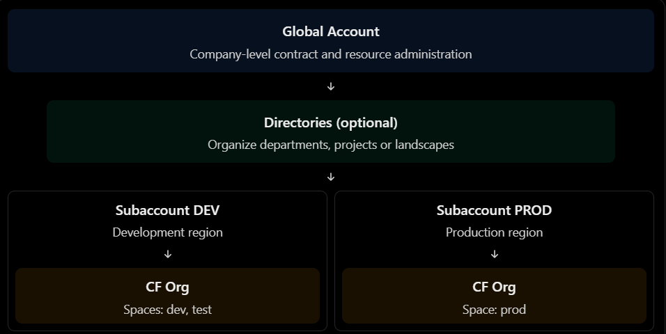
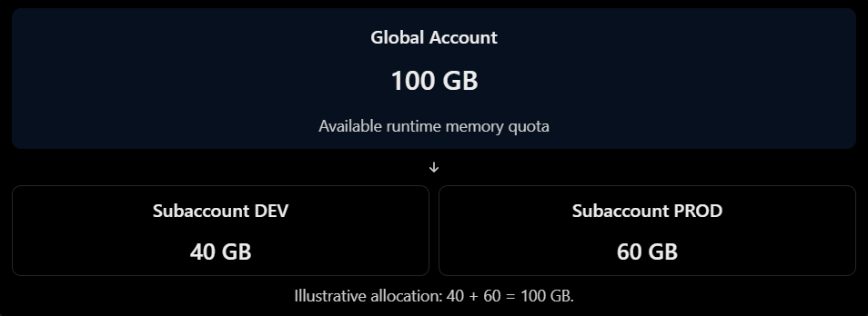
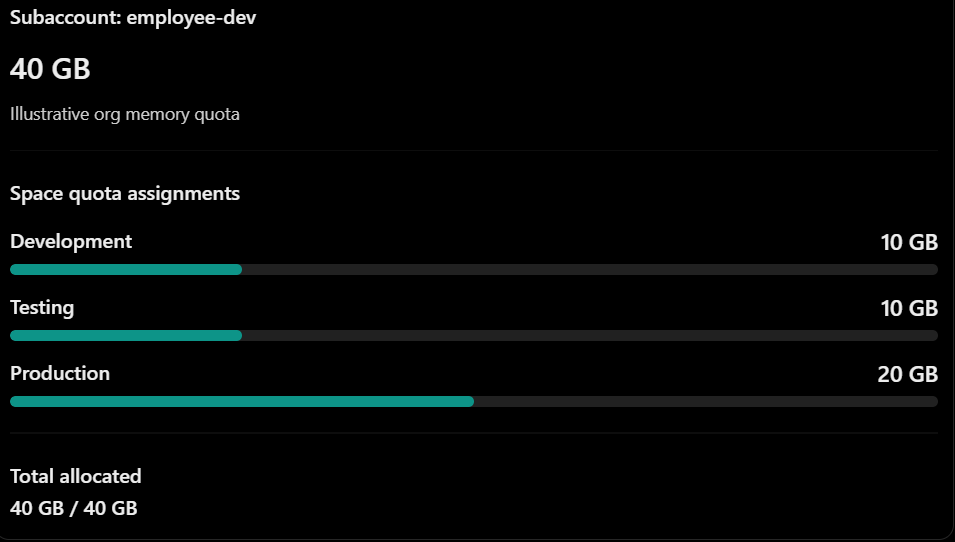
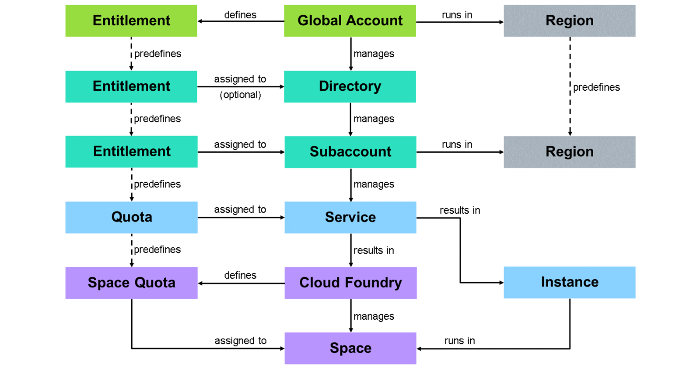

# SAP BTP Cloud Foundry Environment

Think of SAP BTP as the overall platform where your applications, environments and services are managed.
Cloud Foundry is one of the environments available within SAP BTP. It provides the runtime where the Node.js application will execute.

The account hierarchy is:



This is a conceptual example, not a required account structure. SAP documents the account model as a hierarchy of global accounts, optional directories and subaccounts.

Official reading: [Account Model](https://help.sap.com/docs/btp/btp-admin-guide/account-model).

## Global accounts, directories and subaccounts

### Global Account

A Global Accountrepresents the commercial relationship between the company and SAP.

It is where administrators manage:
- Subaccounts.
- Members and authorizations.
- Entitlements and quotas.
- Directories.
- Overall resource distribution.

For example, the company might have one global account containing development, test and production subaccounts.

### Directories

Directories are optional organizational containers between a global account and subaccounts.

For example:
```Global Account: ACME
│
├── Directory: Europe
│   ├── Subaccount: DEV-EU
│   └── Subaccount: PROD-EU
│
└── Directory: North America
    ├── Subaccount: DEV-US
    └── Subaccount: PROD-US
```

They are useful when an enterprise wants to delegate administration or organize subaccounts by geography, business unit or project.

Directories can also participate in entitlement distribution if entitlement management is enabled for them.

### Subaccounts — where developers start working

A Subaccountis where you configure and consume SAP BTP environments and services.

A subaccount is associated with a region and can contain:
- Cloud Foundry environment.
- Cloud Foundry org and spaces.
- Service instances.
- Application subscriptions.
- Destinations and other configuration.
- Members and authorizations.

For example:

```
Subaccount: employee-dev
Region: Europe (Frankfurt)

Cloud Foundry Environment
  └── Org: employee-dev-org
      └── Space: development
          ├── employee-api
          ├── employee-db
          └── employee-xsuaa
```

## Cloud Foundry orgs and spaces

When you enable the Cloud Foundry environment in a subaccount, SAP automatically creates a Cloud Foundry org.

**One SAP BTP subaccount ↔ one Cloud Foundry org.**

You can then create multiple spaces inside that org.

For example:

```SAP BTP Global Account
  └── Subaccount: employee-dev
      └── Cloud Foundry Org: employee-dev-org
          ├── Space: development
          ├── Space: testing
          └── Space: production
```

The subaccount and org are separate concepts, even though they have a one-to-one relationship in this environment. They may also have different names.

### Why might you use multiple subaccounts instead of multiple spaces?

A useful rule of thumb:
- Use **spaces** to separate application teams or workloads within the same subaccount and environment.
- Use **subaccounts** when you need stronger separation of administration, region, security configuration, service consumption or lifecycle.

For instance, development and production may be placed in separate subaccounts if they require different regions, administrators or service configurations.

## Entitlements and quotas

Imagine you've developed your Node.js application, configured its dependencies and run:
```
cf push employee-api
```
But deployment fails with:
```
Error: organization memory limit exceeded
```

The code might be perfectly fine. The problem could be that the Cloud Foundry environment doesn't have enough allocated memory.

### What is an entitlement?

An entitlementis the organization's right to use a particular SAP BTP service or service plan.

For example, the company might be entitled to use:
- SAP HANA Cloud.
- SAP Authorization and Trust Management service (XSUAA).
- Destination service.
- Cloud Foundry runtime.

A service can offer multiple plans. A plan represents a particular service offering or configuration.

For example, a database service might have different plans for different capacities or capabilities.

Think of an entitlement as:
> "Our company is allowed to use this service plan."

It doesn't necessarily mean that an instance has already been created.

### What is a quota?

A quota is the permitted quantity of a resource.

For example:
- 20 GB of Cloud Foundry runtime memory.
- 10 instances of a particular service plan.
- A limit on the number of routes.
- A limit on the number of application instances.

Think of a quota as:
> "Our company is allowed to consume up to this amount."

The difference:
| Concept | Meaning |
| ------- | ------- |
| Entitlement | Permission to consume a service or plan |
| Quota | Maximum quantity you're allowed to consume |
| Usage | Amount currently consumed |

SAP manages entitlements and quotas at global account level and distributes them to subaccounts, where resources are consumed.

Official reading: [Entitlements and Quotas](https://help.sap.com/docs/btp/sap-business-technology-platform/entitlements-and-quotas).

### How quotas are distributed

Let's use a hypothetical company with 100 GB of Cloud Foundry runtime memory available.



An administrator allocates quota to subaccounts. That quota is then available for consumption within the relevant subaccount.

You cannot simply deploy an application using quota that hasn't been allocated to its subaccount.

Official reading: [Managing Entitlements and Quotas Using the Cockpit](https://help.sap.com/docs/btp/sap-business-technology-platform/managing-entitlements-and-quotas-using-cockpit).

### Org quotas and space quotas

In SAP BTP, the runtime quota allocated to a subaccount is reflected in the Cloud Foundry org's resource limits.

The org quota defines the overall resource limits available to its spaces.

You can then distribute those limits using space quota plans.

Let's extend our example:



This is a simplified memory-only example. Real quota plans can also constrain routes, service instances, application instances and other resources.

The important distinction:
- Org quota: the overall limit for the org.
- Space quota: the limit assigned to a particular space.

Space quotas are optional. If you don't assign one, the space shares the org's quota limits. It does not receive a separate, independent copy of the entire quota.

### Why do space quotas matter?

Suppose the development space uses all 40 GB of the org quota.

The production space might then be unable to deploy another application—even if production itself has very little memory usage.

Space quotas help prevent one space from consuming all the resources available to the org.

### Final Diagram



## Service Marketplace

## SAP-specific Cloud Foundry configurations