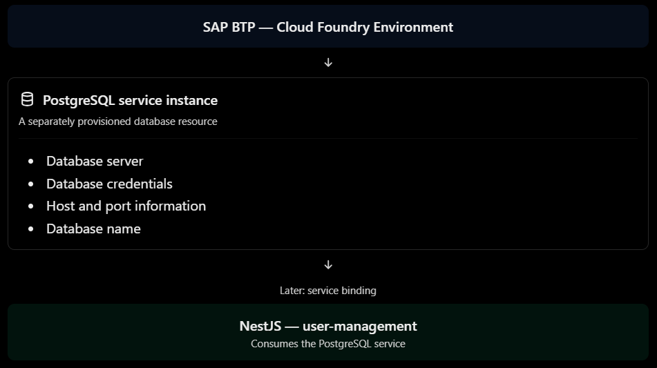
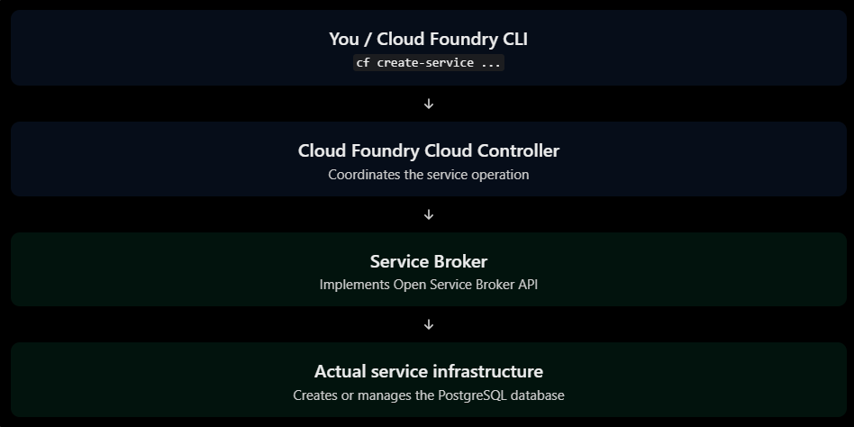

# Services
## Service instances

In Cloud Foundry, applications often depend on external services such as databases, messaging systems, caches, and authentication services.

Instead of installing and managing these services inside your application container, Cloud Foundry allows you to provision them as separate resources.

### What is a service instance?

A service instance is a provisioned instance of a service that an application can consume.

For example, imagine your NestJS application needs PostgreSQL.

You can provision a PostgreSQL service instance in SAP BTP:



The important distinction is that the database is not running inside your NestJS application container. It is a separate service that your application can connect to.

### Service Marketplace

In SAP BTP, the Service Marketplace is where you discover available services for your subaccount and Cloud Foundry environment.

Examples include:

| Service category    | Example                                     |
| ------------------- | ------------------------------------------- |
| Database            | SAP HANA Cloud                              |
| Relational database | PostgreSQL, where offered by your landscape |
| Messaging           | SAP Event Mesh                              |
| Authentication      | Authorization and Trust Management (XSUAA)  |
| Object storage      | Object Store                                |

Availability depends on your SAP BTP region, entitlements, service plans, and provider configuration.

A service offering describes what a provider makes available. A service plan describes a particular configuration or tier of that offering.

For example:

```
Service Offering: PostgreSQL
    |
    +-- Plan: Development
    |
    +-- Plan: Standard
    |
    +-- Plan: Enterprise
```

These are illustrative plan names, not a claim about the plans available in your subaccount.

### Service offering vs. service plan vs. service instance

This distinction is important.

| Concept          | Meaning                                        |
| ---------------- | ---------------------------------------------- |
| Service offering | The type of service provided                   |
| Service plan     | A particular variant or configuration          |
| Service instance | An actual provisioned resource based on a plan |

Think of it this way:

- Offering = PostgreSQL
- Plan = a particular database tier
- Instance = your actual provisioned database

You can create multiple service instances from the same offering and plan.

### Creating a service instance

There are two common ways to create service instances:

#### Option A — SAP BTP Cockpit

1. Open your SAP BTP subaccount.
2. Navigate to the Cloud Foundry environment.
3. Open the Service Marketplace.
4. Select an available service.
5. Choose a service plan.
6. Create the service instance.

#### Option B — Cloud Foundry CLI

The general command is:

```
cf create-service SERVICE_OFFERING SERVICE_PLAN INSTANCE_NAME
```

For example, using illustrative names:

```
cf create-service postgresql development postgres-db
```

This asks Cloud Foundry to provision a service instance named `postgres-db`.

The exact offering and plan names must match what your environment provides.

### Inspecting service instances

Some useful commands:

```
# List all service instances in the targeted space
cf services

# Inspect a specific service instance
cf service postgres-db

# Show available service offerings and plans
cf marketplace
```

Example output from `cf services` might look like:

```
name       service       plan          bound apps
postgres-db    postgresql    development   None
```

Notice the `bound apps` column.

At this stage, the service instance exists, but it is not yet connected.


### Creating, updating, and deleting instances

Other lifecycle commands include:

```
# Update an instance's plan, if supported
cf update-service postgres-db -p standard

# Delete an instance
cf delete-service postgres-db
```

Be careful with deletion: removing a service instance can result in loss of its associated data, depending on the service provider and its behavior.

## Service keys

### What is a service key?

A service key is a set of credentials generated for a service instance.

For example, imagine you have created a PostgreSQL service instance called `postgres-db`.

The service provider may generate credentials containing:

```
{
  "hostname": "postgres.example.com",
  "port": 5432,
  "database": "userdb",
  "username": "db_user",
  "password": "generated-secret",
  "ssl": true
}
```

These credentials allow a client to connect to the database.

The exact structure depends on the service provider.

Important: Creating a service key does not create another database. It creates credentials for accessing an existing service instance.

### Creating a service key

Cloud Foundry provides this command:

```
cf create-service-key SERVICE_INSTANCE SERVICE_KEY_NAME
```

For example:

```
cf create-service-key postgres-db postgres-db-key
```

This creates a service key called `postgres-db-key` for the existing `postgres-db` instance.

To inspect it:

```
cf service-key postgres-db postgres-db-key
```

To list the keys:

```
cf service-keys postgres-db
```

To delete a key:

```
cf delete-service-key postgres-db postgres-db-key
```

### Important security considerations

Service keys contain sensitive credentials.

Follow these practices:

- Never commit service-key credentials to Git.
- Never hardcode database passwords in your NestJS source code.
- Restrict access to service keys.
- Delete keys that are no longer required.
- Rotate credentials when necessary, according to the service provider's supported procedures.

Also, a service key does not automatically make a database accessible over the internet. Network access, IP restrictions, and other provider-specific requirements still apply.

## Service bindings

### What is a service binding?

A service binding establishes a relationship between a Cloud Foundry application and a service instance.

For example, your NestJS application needs to connect to PostgreSQL.

You have already provisioned a service instance:

```
Service instance: postgres-db
Application:      user-management
```

You create a binding between them.


The binding allows the service broker to provide the application with the credentials and connection information needed to consume the service.

Important: A binding does not mean that PostgreSQL runs inside your NestJS container. They remain separate resources.

### Creating a service binding using CF CLI

The command is:

```
cf bind-service APP_NAME SERVICE_INSTANCE
```

For your project:

```
cf bind-service user-management postgres-db
```

This tells Cloud Foundry:

> Bind the PostgreSQL service instance `postgres-db` to the application `user-management`.

After binding, you generally need to restart the application so the updated environment becomes available to its processes:

```
cf restart user-management
```

You can inspect the binding with:

```
cf services
```

The output might look like:

```
name       service       plan          bound apps
postgres-db    postgresql    development   user-management
```

The `bound apps` column now shows the application.

### What happens internally?

Let's follow the process.

1. You execute the binding command
   ```
   cf bind-service user-management postgres-db
   ```
2. Cloud Controller processes the request

   Cloud Controller manages the application and service-binding relationship.
3. The service broker participates

   Cloud Foundry coordinates with the service broker to establish the service binding and obtain the binding credentials.
4. Credentials become available to the application

   Cloud Foundry exposes service information through the system-provided `VCAP_SERVICES` environment variable.
5. The application reads the credentials

   Your NestJS application can read `VCAP_SERVICES` and use the PostgreSQL connection details.

The exact provisioning and credential-generation behavior depends on the service broker and service offering.

### Service bindings in manifest.yml

You can also declare service bindings in your application manifest.

For example:

```yaml
applications:
  - name: user-management
    memory: 512M
    instances: 1
    buildpacks:
      - nodejs_buildpack
    command: npm run start:prod
    services:
      - postgres-db
```

Here:

```yaml
services:
  - postgres-db
```

means that the application should be bound to the existing service instance named `postgres-db`.

When you deploy with:

```
cf push
```

Cloud Foundry processes the declared binding as part of the application deployment configuration.

Note: The service instance must already exist, and the relevant service and plan must be available in your space.

Also, removing a service from the manifest does not necessarily unbind an existing binding automatically. Manage existing bindings explicitly.

### Unbinding a service

Suppose you no longer want your NestJS application to use PostgreSQL.

You can remove the binding:

```
cf unbind-service user-management postgres-db
```

This removes the application-to-service binding.

It does not normally delete the service instance itself.

To delete the service instance separately:

```
cf delete-service postgres-db
```

Be careful: deleting a database service instance may result in data loss.

### Service key vs. service binding — final comparison

| Feature               | Service key                      | Service binding                      |
| --------------------- | -------------------------------- | ------------------------------------ |
| Associated with       | Service instance                 | Application and service instance     |
| Credentials           | Generated for independent access | Provided for application consumption |
| Typical consumer      | External client                  | Application                          |
| Credentials retrieval | `cf service-key`                 | `VCAP_SERVICES`                      |
| CLI creation          | `cf create-service-key`          | `cf bind-service`                    |
| CLI deletion          | `cf delete-service-key`          | `cf unbind-service`                  |

One important security distinction: both mechanisms provide access credentials. Neither should be treated as a substitute for network access controls or credential protection.

## `VCAP_SERVICES`

### What is VCAP_SERVICES?

`VCAP_SERVICES` is a system-provided environment variable that contains information about services bound to a Cloud Foundry application.

It is provided by the Cloud Foundry platform when the application runs.

For example, `nestjs-cf` application previously showed:

```
{
  "VCAP_SERVICES": {}
}
```

This was expected because there was no services bound.

After binding a PostgreSQL service instance, the structure might look like this:

```json
{
  "VCAP_SERVICES": {
    "postgresql-db": [
      {
        "name": "postgres-db",
        "label": "postgresql-db",
        "plan": "trial",
        "tags": ["relational", "database"],
        "credentials": {
          "hostname": "postgres.example.com",
          "port": 5432,
          "dbname": "userdb",
          "username": "db_user",
          "password": "generated-secret",
          ...
        },
        ...
      }
    ]
  }
}
```

Illustrative example only. Actual property names and structure depend on the service broker.

### Understanding the structure

Let's break it down.

| Property      | Meaning                                |
| ------------- | -------------------------------------- |
| `postgresql`  | Service label/category                 |
| `name`        | Service instance name                  |
| `label`       | Service offering label                 |
| `plan`        | Provisioned service plan               |
| `tags`        | Service tags                           |
| `credentials` | Connection information and credentials |

The most important part for your application is:

```json
{
  "credentials": {
    "hostname": "postgres.example.com",
    "port": 5432,
    "database": "userdb",
    "username": "db_user",
    "password": "generated-secret",
    ...
  }
}
```

The application will use these values to establish a connection.

### How does Node.js access VCAP_SERVICES?

Because `VCAP_SERVICES` is an environment variable, you can access it through Node.js:

```
process.env.VCAP_SERVICES
```

Remember that environment variables are strings.

Therefore, you need to parse the JSON:

```js
const vcapServices = JSON.parse(
  process.env.VCAP_SERVICES ?? '{}',
);

console.log(vcapServices);
```

You can also inspect the application information:

```js
const vcapApplication = JSON.parse(
  process.env.VCAP_APPLICATION ?? '{}',
);

console.log(vcapApplication.application_name);
console.log(vcapApplication.space_name);
```

### Extracting PostgreSQL credentials

Suppose your service binding produces the illustrative JSON structure shown earlier.

You can retrieve the credentials like this:

```js
const vcapServices = JSON.parse(
  process.env.VCAP_SERVICES ?? '{}',
);

const postgresServices = vcapServices['postgresql-db'];

if (!postgresServices?.length) {
  throw new Error('PostgreSQL service not bound');
}

const credentials = postgresServices[0].credentials;

console.log(credentials.hostname);
console.log(credentials.port);
console.log(credentials.database);
```

Notice this part:

```js
vcapServices.['postgresql-db'][0].credentials
```

Why `[0]`?

Because Cloud Foundry groups services by their service label, and each group contains an array. You might have multiple PostgreSQL service bindings.

In production code, it's better to select the service by its instance name rather than blindly using the first array element.

For example:

```js
const postgresService = postgresServices.find(
  (service: any) => service.name === 'postgres-db',
);

if (!postgresService) {
  throw new Error('postgres-db service not found');
}

const credentials = postgresService.credentials;
```

See full code reference [here](../nestjs-cf/src/config.ts).

### VCAP_SERVICES vs. VCAP_APPLICATION

You have already seen both variables in your actual CF environment output.

They serve different purposes.

| Variable           | Contains                                               |
| ------------------ | ------------------------------------------------------ |
| `VCAP_APPLICATION` | Application and deployment metadata                    |
| `VCAP_SERVICES`    | Information about bound services and their credentials |

For example:

VCAP_APPLICATION

```json
{
  "application_name": "user-management",
  "space_name": "dev",
  "application_uris": [
    "user-management.cfapps.us10-001.hana.ondemand.com"
  ]
}
```

VCAP_SERVICES

```json
{
  "postgresql": [
    {
      "name": "postgres-db",
      "credentials": {
        "hostname": "postgres.example.com",
        "username": "db_user"
      }
    }
  ]
}
```

Think of it this way:

- `VCAP_APPLICATION`: Information about my application.
- `VCAP_SERVICES`: Information about the services my application consumes.

### How to inspect VCAP_SERVICES in Cloud Foundry

You can inspect the application environment using:

```
cf env user-management
```

This displays:
- Application-defined environment variables.
- Running environment variable groups.
- Staging environment variable groups.
- System-provided variables such as `VCAP_APPLICATION` and `VCAP_SERVICES`.

After binding PostgreSQL, you should see the corresponding service information under `VCAP_SERVICES`.

> Security reminder: `VCAP_SERVICES` can contain database passwords, tokens, and other sensitive credentials.

Avoid:
- Printing the entire variable in production logs.
- Committing its contents to Git.
- Exposing credentials through API responses.
- Sharing unredacted output when troubleshooting.

## User-provided services

### What is a user-provided service?

A user-provided service is a service instance whose connection information you provide manually through the Cloud Foundry CLI.

Unlike a marketplace service:
- Cloud Foundry doesn't provision the underlying database.
- There is no service broker managing its lifecycle.
- You provide the credentials and connection information yourself.
- You can still bind the service to your application.

For example, imagine you have an external PostgreSQL database:

```
Host: postgres.example.com
Port: 5432
Database: users
Username: app_user
Password: ********
```

You can represent this database as a user-provided service in Cloud Foundry.

### Creating a user-provided service

Use:

```
cf create-user-provided-service SERVICE_NAME -p "credentials"
```

For example:

```
cf create-user-provided-service external-postgres -p '{"hostname":"postgres.example.com","port":5432,"dbname":"users","username":"app_user","password":"secret"}'
```

Here:

| Property            | Meaning                         |
| ------------------- | ------------------------------- |
| `external-postgres` | Name of the CF service instance |
| `-p`                | Supplies credentials as JSON    |
| `hostname`          | Database hostname               |
| `port`              | Database port                   |
| `dbname`            | Database name                   |
| `username`          | Database username               |
| `password`          | Database password               |

The values are illustrative.

You can inspect it with:

```
cf services
cf service external-postgres
```

### Binding it to your application

The binding process is familiar:

```
cf bind-service user-management external-postgres
cf restart user-management
```

After binding, Cloud Foundry makes the supplied credentials available through `VCAP_SERVICES`.

Your application can access them using the same general approach as before:

```
const vcapServices = JSON.parse(
  process.env.VCAP_SERVICES ?? '{}',
);
```

Important: The service label and credential structure for a user-provided service differ from those of a marketplace service. Don't assume the key will be `postgresql-db`.

### Marketplace service vs user-provided service

| Feature                     | Marketplace service      | User-provided service |
| --------------------------- | ------------------------ | --------------------- |
| Created through             | Service broker           | CF CLI                |
| Infrastructure provisioned  | Usually yes, by provider | No                    |
| Credentials supplied by     | Broker                   | You                   |
| Lifecycle managed by broker | Yes                      | No                    |
| Can be bound to apps        | Yes                      | Yes                   |
| Appears in `VCAP_SERVICES`  | Yes                      | Yes                   |

One key distinction: a user-provided service is only a representation of connection information. Creating it does not create a PostgreSQL database or guarantee that your application can reach the external database.

You still need valid credentials, network connectivity, firewall access, and any required TLS configuration.

### When would you use it?

Typical scenarios include:

- Connecting to an existing database hosted outside SAP BTP.
- Connecting to an internal company API.
- Providing credentials for an external service that doesn't have a suitable marketplace broker.
- Representing connection details for a legacy system.

Be careful with credentials: avoid putting real passwords directly into shell history, scripts, or source control. Restrict access to the service instance and rotate credentials when necessary.

## Open Service Broker API

### The problem OSBAPI solves

Imagine SAP BTP offers PostgreSQL through a service marketplace.

When you execute:

```
cf create-service postgresql development postgres-db
```

Cloud Foundry needs to communicate with the PostgreSQL service provider and ask it to provision a database.

But how does Cloud Foundry know how to communicate with that provider?

The answer is a standardized API: Open Service Broker API.

It defines how a platform communicates with service brokers.

### What is a service broker?

A service broker is a component that exposes the service offering to Cloud Foundry.

It acts as an intermediary between Cloud Foundry and the actual service infrastructure.

For example:



The broker doesn't necessarily host the database itself. It can communicate with infrastructure managed by another system.

### Important OSBAPI operations

The API defines several operations. These are particularly important:

| Operation      | Purpose                                               |
| -------------- | ----------------------------------------------------- |
| Catalog        | Discover available service offerings and plans        |
| Provision      | Create a service instance                             |
| Deprovision    | Delete a service instance                             |
| Bind           | Create application-specific access credentials        |
| Unbind         | Remove an application binding                         |
| Update         | Change service plan or configuration, where supported |
| Last operation | Check the progress of asynchronous operations         |

Let's connect these to commands you've already used.

#### A. Provision

You execute:

```
cf create-service postgresql development postgres-db
```

Conceptually:

```
Cloud Controller
       |
       | Provision request
       v
Service Broker
       |
       v
Create PostgreSQL database
       |
       v
Return operation status
```

Some services provision asynchronously. Cloud Foundry may need to poll the broker to check whether provisioning has finished.

#### B. Bind

You execute:

```
cf bind-service user-management postgres-db
```

Conceptually:

```
Cloud Controller
       |
       | Bind request
       v
Service Broker
       |
       v
Generate application credentials
       |
       v
Return credentials
       |
       v
VCAP_SERVICES
```

The credentials are then made available to your application through the service binding environment.

#### C. Unbind and deprovision

You execute:

```
cf unbind-service user-management postgres-db
```

This removes the application's binding.

Then:

```
cf delete-service postgres-db
```

This requests deletion of the service instance itself.

These are separate operations: unbinding an application doesn't automatically delete the database.

### Synchronous vs asynchronous operations

Not every service operation finishes immediately.

For example, provisioning a database might take several minutes.

The broker can respond with an indication that the operation is in progress. Cloud Foundry then checks its status through the OSBAPI last-operation mechanism.

Conceptually:

```
Provision request
       |
       v
Broker: operation accepted
       |
       v
Cloud Controller checks status
       |
       +---- Still in progress
       |          |
       |          v
       |      Check again
       |
       +---- Succeeded
                  |
                  v
             Service ready
```

This is why a service can temporarily show a provisioning or update-in-progress status.

Remember the distinction:

- Cloud Controller coordinates the operation.
- Service broker implements the service-management API.
- Service provider infrastructure supplies the actual database or other service.

## CredHub (conceptual)